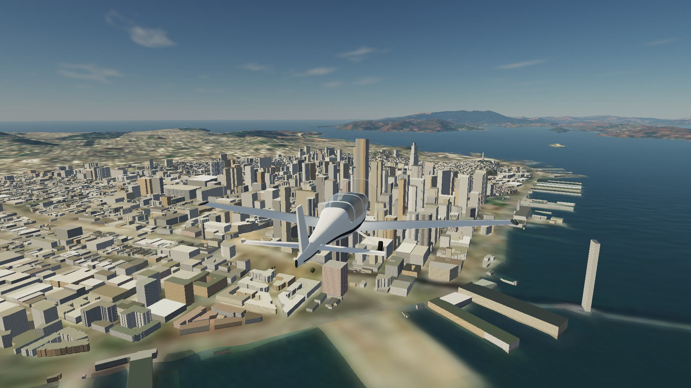

# Cayley

A flight simulator that runs in a browser tab. No build step, no assets, no
plugins: real physics, a working cockpit, synthesised sound and live weather
over real terrain, anywhere on Earth.



Nine aircraft, each built from its published geometry and flown, headless,
against its own handbook: 213 of 223 checks inside tolerance, the misses
published in [validation.html](validation.html).

## Run it

It is a static site: any web server will do.

```bash
python3 -m http.server 8906
```

Then open http://localhost:8906. There is nothing to install and nothing to
build. Chrome, Edge, Safari and Firefox with WebGL 2; a keyboard is enough, a
joystick or gamepad is picked up automatically.

The tests need Node 20 or later and no packages:

```bash
npm test
```

## What is real

**Flight model** (`js/fdm.js`). A 6-DOF rigid body, stepped at 240 Hz, that
builds itself from an aircraft definition: published geometry, masses, engine
and propeller. Nothing is a lookup table of how the aircraft should behave.

- The wing is a lifting line of 40 strips. Each is a horseshoe vortex, and
  each flies in the downwash of all the others, solved every step. The
  spanwise lift distribution, induced drag, roll damping and the way a stall
  spreads out from the root are results, not inputs.
- Ground effect is a mirror-image vortex system under the runway.
- The tail is 12 strips flying in the wake the wing's vortices actually leave
  (trailing legs streaming back along the airflow, plus the bound vortex),
  delayed by the time the wake takes to arrive.
- The propeller is its blades: ten stations a blade, each an aerofoil at its
  own blade angle, in the air the disc is already pulling through itself
  (momentum theory with tip loss, compressibility at the tips). Thrust,
  torque, windmilling, P-factor and the swirl that pushes the fin come from
  the blades. A constant-speed propeller is the same blades with a governor.
- The fuselage is eight stations, each in its own local flow, with the
  destabilising moment a slender body carries. Gear and struts drag where
  they hang.
- Engine power lapse with density altitude, mixture leaning, fuel burn.
- Sprung, damped gear with tyre friction, brakes and steering; tailwheel
  aircraft are directionally unstable on the ground because the geometry is.
- Each aircraft is rigged like a real one: the rudder tab and aileron rig it
  needs to fly hands-off in cruise are found by flying it.

About 60 microseconds a step in JavaScript: a quarter of a millisecond a frame.

**Aircraft** (`js/aircraft/`). One definition file each, with its sources in
the header and the handbook figures it is flown against. Geometry, weights,
engine and propeller data are fixed from the type certificate data sheet and
the handbook; only what is genuinely uncertain (section maximum lift, profile
drag, flap increments, parasite drag, propeller pitch) is tuned, inside
physical ranges, and a figure that cannot be met is left as a miss.

| Aircraft | Checks inside tolerance | What misses |
|---|---|---|
| Cessna 172S | 32 of 32 | |
| Cessna 152 | 28 of 28 | |
| Cessna 182T (constant-speed) | 28 of 28 | |
| Cirrus SR22 (constant-speed) | 26 of 26 | |
| Piper PA-28-181 Archer | 26 of 27 | landing roll short of the book |
| Robin DR400-180 | 25 of 26 | landing roll short of the book |
| Piper J-3 Cub (tailwheel) | 17 of 18 | engine-out glide, 7.8 against 10 |
| Extra 300L (aerobatic) | 21 of 26 | roll rate 237 against about 370 deg/s; takeoff and landing rolls; brakes cannot hold full power |
| Schleicher ASK 21 (glider) | 10 of 12 | two generic wing checks that assume an untapered wing |

213 of 223 as of November 2026. The Extra's roll rate is the instructive miss:
it is what the geometry and textbook aileron effectiveness give, and the real
aircraft's ailerons do better than the textbook.

`node test/validate.mjs all` flies every aircraft headless at maximum weight:
handbook performance, handling (phugoid, Dutch roll, roll rate, stall break
and recovery) and a wind-tunnel check of what the vortex model produces on its
own (lift-curve slope, span efficiency, loading, ground effect).
`node tools/validation-page.mjs` writes the whole run to `validation.html`,
misses included.

**Systems** (`js/systems.js`). The panel shows what the instruments make of
the truth, not the truth.

- Airframe ice builds when the aircraft is inside visible cloud (the same
  cloud field that is drawn) below freezing: less maximum lift, more drag,
  more weight, a rougher propeller. The pitot ices faster unless heated, and
  a blocked airspeed indicator then behaves like an altimeter.
- Attitude and heading gyros are spun by an engine-driven vacuum pump. Lose
  it and the attitude indicator leans over slowly with no flag. The heading
  gyro drifts (bearing friction, and the Earth turning under it) and has to
  be reset to the compass.
- The magnetic compass is a magnet on a float hanging along the apparent
  vertical, in a field that dips toward the ground. Its turning and
  acceleration errors are not coded: they fall out.
- Alternator, battery and loads; two fuel tanks and a selector; two magnetos;
  carburettor ice on carburetted engines; oil loss ending in a seized engine.
- Ten failures, injected from the Faults list or at random.

`node test/systems.mjs` checks these against what pilots are taught to expect.

**Terrain** (`js/terrain.js`). A quadtree of web-mercator tiles around the
aircraft: real elevation (Terrarium tiles, SRTM-class) under satellite
imagery. The default picture is Sentinel-2 at 10 m a pixel, which is sharp
from cruise height and soft near the ground; see [Imagery](#imagery) for a
sharper source. The physics reads
ground height off the same mesh that is drawn. Runways are levelled to their
surveyed threshold elevations. Where the picture is too coarse to show them,
paved runways are drawn in the terrain shader (`js/runway-paint.js`):
asphalt or concrete, threshold bars, designation, touchdown zone, aiming
point, centreline and rubber, sized to each runway's width and length after
ICAO Annex 14. The Earth's curvature is in the vertex shader.

**Scenery** (`js/scenery.js`, `js/mvt.js`). What stands on the land comes
from OpenStreetMap, streamed as vector tiles (OpenFreeMap, no key) and decoded
in the browser by a small protobuf reader, a few milliseconds a frame.

- Water. The map's water polygons are rasterised into a mask for every terrain
  tile, and the terrain shader treats masked ground as water: the photograph
  underneath smoothed and darkened, a Fresnel mirror of the same sky the dome
  draws, and the sun's glitter on four trains of drifting ripples. Ripples too
  fine for a pixel turn into roughness, so the sun's path widens toward the
  horizon instead of shimmering. Bridges are cut back out of the mask.
- Buildings. Footprints within about 4 km, extruded to the height the map
  gives (a real height or a storey count; where it has neither, a guess from
  the footprint), one mesh per map tile. Small rectangles get a pitched roof.
  Roofs take their colour from the satellite picture under them. Windows by
  day, some of them lit at night.
- Trees. Scattered through mapped woodland within about 2 km, kept off water,
  roads, buildings and airfields, instanced, coloured from the picture, firs
  taking over from broadleaves with altitude and latitude.

Everything is stood on the terrain mesh that is on screen and stood again
when that mesh sharpens.

**Airports** (`js/airports.js`). Sixteen picked places plus any airport by
ICAO code. Thresholds, elevations and widths come from OurAirports. The
departure runway is the one that best faces the wind. Edge lights, threshold
bars and a working PAPI.

**Weather** (`js/weather.js`). Open-Meteo, for the airport, for this hour:
temperature, dew point, QNH, visibility, precipitation, cloud cover by level,
and wind at 10 m, 80 m, 180 m and on pressure levels up to 500 hPa. From that:
the real density the wing and engine feel, the real altimeter setting, a wind
profile to climb through, cloud base at the lifting condensation level,
turbulence from gusts, convection and cloud, and orographic lift where the
wind meets the real terrain slope.

**Sky and clouds** (`js/atmo.js`, `js/clouds.js`, `js/sky.js`). The sun is
where it really is for the date, time and place. One single-scattering
atmosphere drives the sky dome, the haze over the terrain and the light on
the clouds. Two raymarched cloud layers and a cirrus sheet; their coverage
map also casts the cloud shadows on the ground. Rain and snow fall outside
the aircraft, never inside the cabin. Rain lands on the windscreen and
windows (`js/glass-rain.js`): it sits in beads while the aircraft is slow,
runs up the windscreen and back along the side windows once the airflow can
push it, and dries off after you leave the rain. Night, with stars, town
lights and lit instruments.

**Cockpit** (`js/cockpit.js`). The inside of the same aircraft model.
Airspeed, attitude, altimeter (three needles, Kollsman window), turn
coordinator with the ball, heading, vertical speed, tachometer, fuel, oil,
EGT and fuel flow, drawn live from the flight model's instrument outputs.
A moving-map box that points back to the airport. Sun patches move across
the panel as you turn.

**Navigation** (`js/nav.js`). Real VOR, DME and NDB stations from the
OurAirports navaid file: position, frequency, elevation, power class and the
declination each VOR was aligned to. One NAV receiver with an OBS, a DME, an
ADF and a GPS direct-to. The panel has a VOR/ILS indicator (course and
glideslope needles, TO/FROM, NAV and GS flags) above the tachometer and an ADF
below it; the radio stack shows the NAV1 frequency, the ident once the station
is actually received, DME distance, closing speed and time to the station.

- Reception is worked out, not assumed. VHF needs line of sight over a smooth
  Earth with 4/3 refraction, inside the station's service range (25 to 130 NM
  by class). An NDB follows the ground and needs none. Straight over a VOR
  the flag drops in the cone of confusion while the DME reads your height.
- Radials, the OBS and localizer courses are magnetic. Full scale is 10° on a
  VOR, 2.5° on a localizer, 0.7° on the glideslope. DME is slant range, and
  its speed is the rate that range closes, so it reads low off to one side.
- Every runway end of the airport has an ILS: a localizer 300 m past the far
  end, a 3° glideslope from 300 m past the threshold (where the PAPI sits)
  and a DME. The localizer is heard 10° either side to 25 NM and 35° to
  17 NM, the glideslope 8° either side to 10 NM between 1.35° and 5.25°.
  Behind the aerial there is a back course, and flown inbound it reads
  reversed. **OurAirports has no ILS data: the geometry follows the surveyed
  runway, but the frequencies and idents are assigned by the sim and are not
  the real ones.** They are fixed per runway (108.10 to 111.95, odd tenths).
- The autopilot couples to it. NAV intercepts the selected course at up to
  45° and tracks it; APR also captures the glideslope from below and flies it
  down. It is never told the wind: the crab angle comes from how the needle
  moves against heading and airspeed. Take over by 200 ft; it does not flare.

`node test/nav.mjs` checks the geometry against 58 cases worked by hand, then
flies the real flight model down a coupled ILS from 8 km and along a VOR
radial. At the threshold it is within 5 cm of the centreline and the
glidepath in still air and in a steady 10 m/s crosswind (the signal has no
noise, so a steady wind is found exactly), and 3.6 m and 0.4 m off in the same
wind with 1 m/s gusts.

**Sound** (`js/engine-worklet.js`). Synthesised sample by sample from the
physics: four cylinders firing through exhaust resonances at crank speed,
blade-pass tone, airflow by dynamic pressure, tyres, touchdown, the reed
stall horn rising in pitch, flap motor, starter, rain. Muffled in the cabin,
with Doppler in the fly-by view.

## Keys

Arrows yoke · A D rudder · W S throttle (airbrakes in a glider) · F V flaps ·
I K trim · , . propeller lever · M N mixture · Space brakes · B parking brake ·
E engine · Z autopilot (arrows then set heading and altitude).

Navigation: U J tune NAV 1 through stations in range · O L course knob ·
Y centre the course · X autopilot follows the NAV course · G autopilot flies
the approach · 4 5 tune the ADF · 6 GPS direct-to · 7 indicator source.

Systems: 8 pitot heat · 9 set the heading gyro to the compass · 0 fuel tank ·
- carburettor heat · Q altimeter to QNH. The Faults list injects failures.

With the keyboard, two assists stand in for hands and feet: the rudder is
worked to keep the ball centred, and with the roll keys released the yoke is
held just enough to stop the aircraft rolling, so it stays at the bank you
left it. On the ground the rudder is yours.

C view (1 cockpit, 2 chase, 3 fly-by) · drag to look, wheel to zoom ·
T time +1 h · H HUD · R restart · P pause · Esc menu. Keys are read by
position, so AZERTY works unchanged. A gamepad or joystick is picked up
automatically.

## Where it stands

A survey of live browser simulators in November 2026 found the best-known one
flying a thin-aerofoil formula per surface with hand tuning, another on a
coefficient model, none modelling failures or icing, and none publishing
validation. On flight physics, systems and published evidence this is ahead of
what is hosted today. It is behind on aircraft count, multiplayer, live
traffic, ATC, mobile and community, and one unhosted project uses comparable
methods across more types, helicopters included.

## Honest limits

- No ATC, traffic or flight planning. No twins, turbines, jets or helicopters.
- The panel is the same steam-gauge panel in every aircraft, with that
  aircraft's airspeed limits and redline. The 3D models are built from the
  flight geometry, so they are the right shape but plain.
- Not flown by a pilot. The numbers show each aircraft performs like its
  handbook; they do not show it feels right in the hand.
- Radio navigation: ILS frequencies are invented (see Navigation). Terrain
  does not block a signal, there is no Morse ident to listen to, and none of
  the real errors (ADF dip, night effect, scalloping, false glideslopes).
  One NAV radio. Variation is the nearest station's surveyed figure, which
  can be years old. The heading indicator, compass and courses are magnetic.
- Buildings are plain extrusions of what OpenStreetMap has: no landmarks, no
  bridges, no textures, and where nobody has mapped a height the height is a
  guess. Where nobody has mapped buildings at all there are none.
- Trees stand only where woodland is mapped as an area: no street trees,
  hedges or orchards. Narrow streams mapped as a line are not water.
- Nothing casts a shadow on the ground except the aircraft and the clouds.
- The local frame is flat around the departure airport; good for a few
  hundred kilometres, not for crossing an ocean.
- The default imagery is 10 m a pixel: sharp from cruise height, soft near
  the ground. Paved runways are drawn over it, but taxiways, aprons and
  everything else on the airfield are only what the picture shows.
- Every map, weather and airport request goes from your browser straight to a
  free public service. None of them promises to be there, and a busy day can
  slow them down.

## Imagery

The satellite picture is the one data source with real licence terms, so it
is the one thing a host can change, in [js/config.js](js/config.js).

- **Default: EOX Sentinel-2 cloudless 2016.** Open (CC BY 4.0), no key, the
  whole planet at 10 m a pixel.
- **Your own source.** Any web-mercator tile service you hold a licence for.
  Esri World Imagery, for one, is under a metre a pixel over most towns; it
  needs an ArcGIS Location Platform API key, which has a free monthly
  allowance. To use a key in your own browser without touching the code,
  paste this in the console and reload:

```js
localStorage.setItem('cayley.imagery', JSON.stringify({
  url: 'https://ibasemaps-api.arcgis.com/arcgis/rest/services/World_Imagery/MapServer/tile/{z}/{y}/{x}?token=YOUR_KEY',
  maxZoom: 17, emptyBelow: 2600,
  credit: 'Powered by Esri · Imagery © Esri, Maxar, Earthstar Geographics',
}));
```

A key in a public page can be read by anyone, so restrict it to your site's
address in the provider's dashboard. If a source of your own stops answering,
the page goes back to the default by itself.

## Data and credits

Everything is fetched by the page at run time; nothing is bundled.

- Imagery: [EOxCloudless](https://cloudless.eox.at) by
  [EOX IT Services GmbH](https://eox.at) (contains modified Copernicus
  Sentinel data 2016 & 2017), CC BY 4.0.
- Elevation: Mapzen terrain tiles on AWS Open Data, built from SRTM, 3DEP,
  EU-DEM, ETOPO1 and others; the full list is in the
  [Tilezen attribution](https://github.com/tilezen/joerd/blob/master/docs/attribution.md).
- Buildings, water and woodland: [OpenFreeMap](https://openfreemap.org)
  vector tiles © [OpenMapTiles](https://openmaptiles.org), data from
  [OpenStreetMap](https://www.openstreetmap.org/copyright) contributors, ODbL.
- Weather: [Weather data by Open-Meteo.com](https://open-meteo.com), CC BY
  4.0. Its free API is for non-commercial use.
- Airports, runways and navaids: [OurAirports](https://ourairports.com),
  public domain.
- [three.js](https://threejs.org) r184, MIT, vendored in `vendor/`.

## Not for real flying

This is a simulator for curiosity and fun. It is not a training device and
nothing in it is fit for navigation: the ILS frequencies are invented, the
navaid and runway data come as they are, and the aircraft are models tuned to
published figures, not certified data.

Aircraft names are used only to say which aircraft is modelled. Cayley is not
affiliated with or endorsed by any manufacturer.

## Licence

MIT, see [LICENSE](LICENSE). The data sources above keep their own terms.
